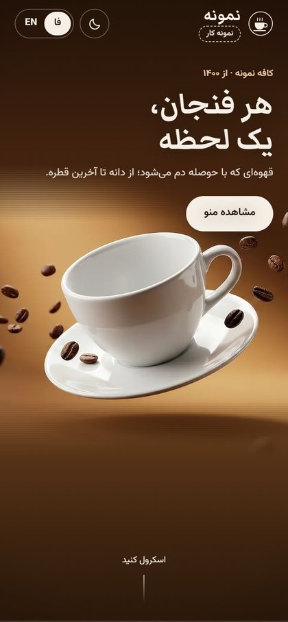
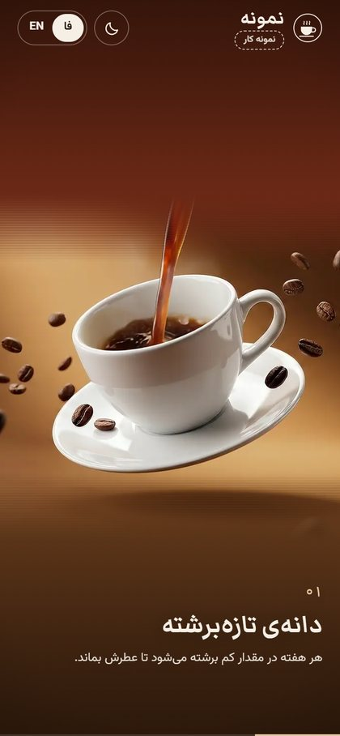
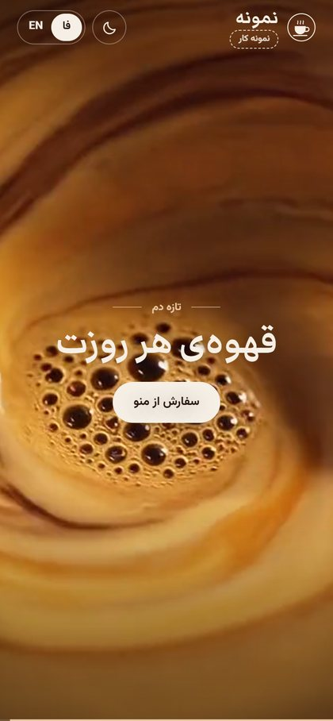
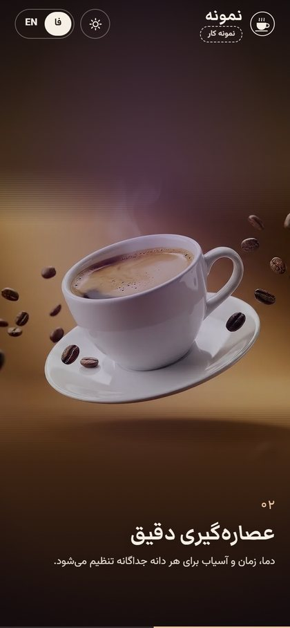
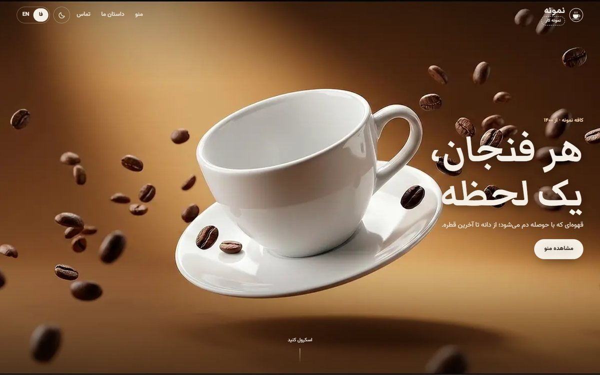
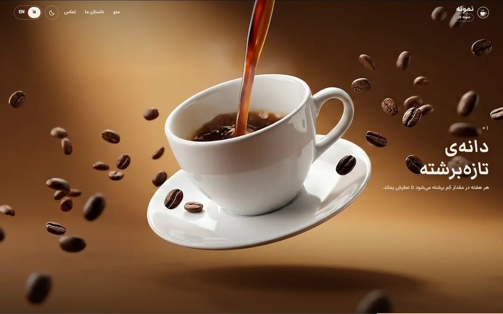
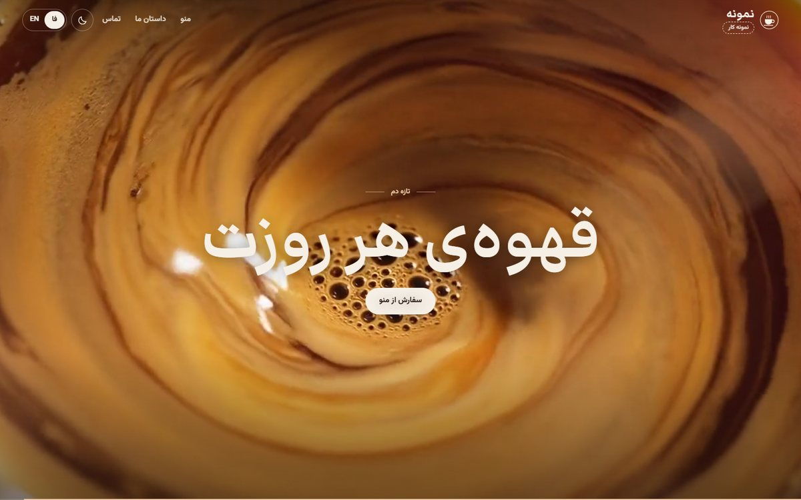

<div dir="rtl">

# وب‌سایت سینمایی کافه — نمونه کار

صفحه‌ی اول کافه‌ای که مثل یک تیزر تبلیغاتی با اسکرول جلو می‌رود: قهوه در فنجان ریخته می‌شود، دوربین داخل فنجان می‌رود
و به نمای نزدیک قهوه‌ی در حال چرخش می‌رسد. همه‌ی تصاویر واقعی‌نما هستند، نه کارتونی.

> این یک **نمونه کار** است. نام کافه («نمونه»)، قیمت‌ها و اطلاعات تماس نمایشی‌اند.

**🔗 دموی زنده:** https://ye8754467545-ship-it.github.io/coffee-cinematic-demo/

<p align="center">
  
  
  
  
</p>
<p align="center"></p>
<p align="center"> </p>

## امکانات

- صحنه‌ی سینمایی که با اسکرول جلو و عقب می‌رود (۱۹۲ فریم روی canvas، بدون کتابخانه‌ی انیمیشن)
- انتقال نرم از ریختن قهوه به حرکت دوربین و بعد به ویدیوی حلقه‌ای چرخش قهوه
- در موبایل، فنجان کامل دیده می‌شود و لبه‌های ویدیو با رنگ خود فریم در پس‌زمینه محو می‌شوند
- بارگذاری تدریجی فریم‌ها (اول هر چهارمین فریم، بعد بقیه) تا صفحه زود قابل استفاده باشد
- دو زبان فارسی و انگلیسی با راست‌به‌چپ و چپ‌به‌راست
- حالت روز و شب (در شب ویدیو کم‌نورتر می‌شود و نور بنفش ملایم می‌گیرد)
- **منوی QR کامل**: ۲۰ دسته و ۹۶ محصول، جست‌وجو، صفحه‌ی جزئیات محصول و QR که مستقیم به `#menu` می‌رود
- پایین صفحه با طراحی مینیمال: تیتر بزرگ، سه ردیف شماره‌دار با عکس، فروشگاه با سبد خرید نمایشی و فوتر

## اجرا

```bash
npm install
npm run dev      # http://localhost:5173
npm run build    # خروجی در dist/
```

با هر push روی `main`، سایت به‌صورت خودکار روی GitHub Pages منتشر می‌شود
(`.github/workflows/deploy.yml`؛ Settings → Pages → Source: **GitHub Actions**).

## ساختار

| مسیر | محتوا |
| --- | --- |
| `src/components/ScrollStage.jsx` | صحنه‌ی اسکرول: پخش فریم‌ها، انتقال‌ها و متن‌های روی ویدیو |
| `src/i18n.jsx` | همه‌ی متن‌های فارسی و انگلیسی |
| `src/components/Sections.jsx` | معرفی، ردیف‌های شماره‌دار، فروشگاه، فوتر |
| `src/components/Menu.jsx`, `src/menu/` | منوی QR: داده‌ی محصولات، دسته‌ها و عکس‌ها |
| `src/config.js` | آدرسی که داخل QR منو قرار می‌گیرد |
| `public/seq/pour`, `public/seq/dive` | فریم‌های webp ویدیوها (۱۲ فریم در ثانیه، ۱۲۸۰ پیکسل) |
| `public/media/swirl.mp4` | ویدیوی حلقه‌ای بی‌درز چرخش قهوه |

## منبع تصاویر

ویدیوها و عکس‌های صفحه با هوش مصنوعی (Google Flow: Veo و Nano Banana) ساخته شده‌اند.
عکس‌های منو از Wikimedia Commons با مجوزهای آزاد است؛ نام عکاس و مجوز هر عکس در فوتر سایت آمده است.

</div>

---

**English:** A cinematic, scroll-driven café landing page built as a portfolio piece. React + Vite, canvas image-sequence playback, bilingual (Persian RTL / English LTR), light and dark themes. Includes a full QR menu (categories, search, detail sheet). AI-generated footage and page photos (Google Flow); menu photos from Wikimedia Commons. The café name, prices and contact details are placeholders.
